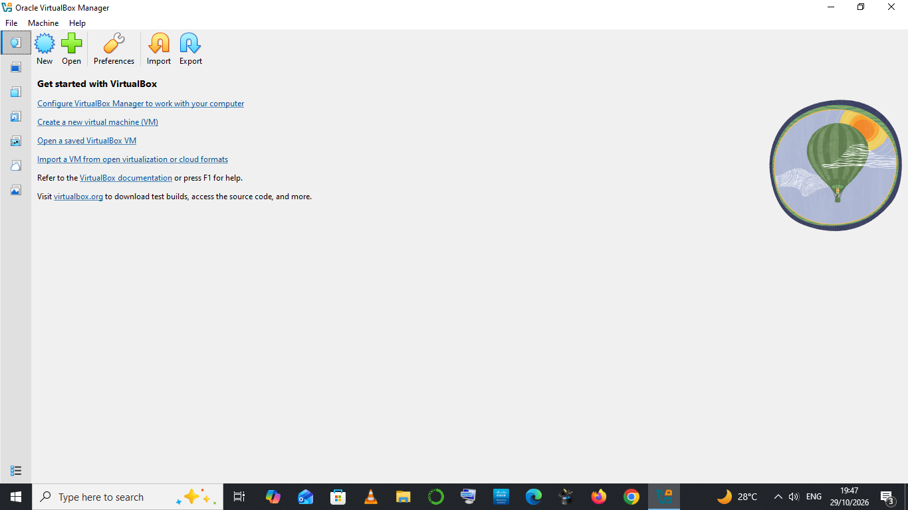
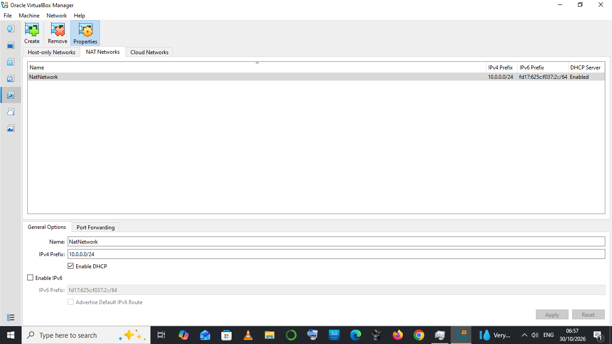
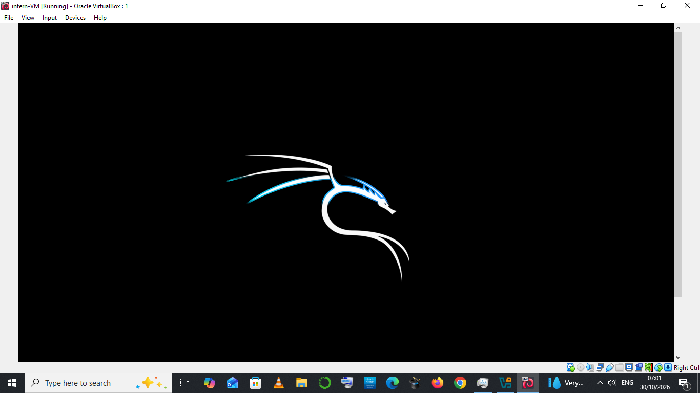
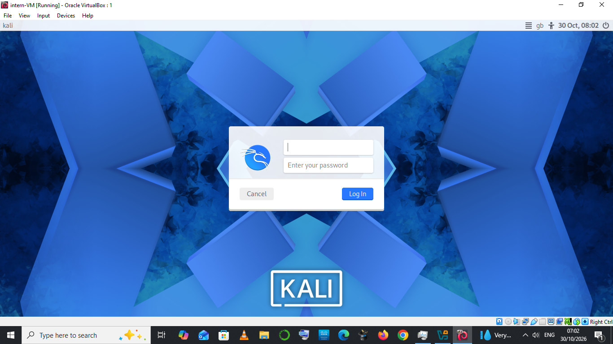

# Kali Linux Lab Setup on VirtualBox

**NetworkWalks Internship | Week 1 Assessment**
**Author:** Ahmed Umar 
**Date:** 30th Octorber 2026

---

## Overview

This project documents how I built an isolated cybersecurity lab by installing Kali Linux inside Oracle VirtualBox. The lab gives me a safe environment to practice networking and security tools without putting my host machine at risk.

**Goals**
- Install and configure VirtualBox
- Create and configure a Kali Linux virtual machine
- Update the system and install Guest Additions
- Verify networking
- Take a snapshot as a clean rollback point

---

## Requirements

| Item | Details |
|------|---------|
| Host OS | Windows 11 / macOS / Linux |
| Host RAM | 16 GB |
| Host CPU | 4 cores / 8 threads |
| Free disk space | At least 60 GB |
| Virtualization | Enabled in BIOS/UEFI (Intel VT-x or AMD-V) |
| VirtualBox | you can use any version |
| Kali Linux | you can use any version |

**VM resources used:** 4 GB RAM, 2 CPUs, 40 GB dynamically allocated disk, NAT Network (`NatNetwork`, 10.0.0.0/24, DHCP enabled).

---

## Step 1: Install VirtualBox

1. Go to [virtualbox.org/wiki/Downloads](https://www.virtualbox.org/wiki/Downloads).
2. Download the installer for your host OS.
3. Run the installer and accept the defaults.
4. Launch VirtualBox and confirm it opens.



---

## Step 2: Download Kali Linux

1. Go to [kali.org/get-kali](https://www.kali.org/get-kali/).
2. Download the **Installer** ISO (64-bit), or the pre-built VirtualBox image.
3. Verify the download integrity by comparing the SHA-256 hash with the one on the Kali site:

**Linux/macOS**
```bash
sha256sum kali-linux-*-installer-amd64.iso
```

**Windows (PowerShell)**
```powershell
Get-FileHash .\kali-linux-*-installer-amd64.iso -Algorithm SHA256
```

---

## Step 3: Create the Virtual Machine

1. In VirtualBox, click **New**.
2. Fill in:
   - **Name:** `intern-VM`
   - **ISO Image:** select the Kali ISO
   - **Type:** Linux
   - **Version:** Debian (64-bit)
   - Check **Skip Unattended Installation**
3. **Hardware:** Base Memory **4096 MB**, Processors **2**.
4. **Virtual Hard Disk:** Create new, **40 GB**, dynamically allocated.
5. Click **Finish**.

Then open **Settings** and adjust:
- **System > Motherboard:** enable I/O APIC (usually on by default)
- **Display > Screen:** Video Memory **128 MB**
- **General > Advanced:** Shared Clipboard set to **Bidirectional**
- **Network > Adapter 1:** Attached to **NAT Network**, name `NatNetwork`

I created the NAT network under **Tools > Network** (NAT Networks tab > **Create**), with IPv4 prefix `10.0.0.0/24` and **DHCP enabled**.



---

## Step 4: Install Kali Linux

1. Start the VM. At the boot menu, choose **Graphical install**.
2. Select language, location, and keyboard layout.
3. Set the hostname (e.g., `kali-lab`) and leave the domain blank.
4. Create a non-root user and a strong password.
5. Partitioning: **Guided - use entire disk**, then **All files in one partition**, then finish and write changes.
6. Software selection: keep the defaults (Xfce desktop plus the default tools).
7. Install GRUB to the primary drive when prompted.
8. When it finishes, click **Continue** to reboot. Remove the ISO from the virtual drive if prompted.





---

## Step 5: Update and Configure

Open a terminal and run:

```bash
sudo apt update
sudo apt full-upgrade -y
sudo reboot
```

After the reboot, confirm the system details:

```bash
uname -a
cat /etc/os-release
whoami
hostname
```

---

## Step 6: Install Guest Additions

Guest Additions enable full-screen resolution, shared clipboard, and drag and drop.

**Option A: Install from the Kali repositories (recommended)**
```bash
sudo apt install -y virtualbox-guest-x11 virtualbox-guest-utils
sudo reboot
```

**Option B: Install from the VirtualBox menu**
1. In the VM window, choose **Devices > Insert Guest Additions CD Image**.
2. Run the installer from the mounted disc:
```bash
cd /media/cdrom0
sudo sh ./VBoxLinuxAdditions.run
sudo reboot
```

**Verify**
```bash
lsmod | grep vbox
```

Resize the window or enter full-screen mode (Host key + F) to confirm the display scales, and test copy/paste between host and VM.

---

## Step 7: Snapshot

A snapshot saves the VM's clean state so I can roll back after experiments.

1. In VirtualBox, select the VM and open the **Snapshots** tab.
2. Click **Take**.
3. Name it `Clean Install - Updated` and add a short description.

Command-line alternative:
```bash
VBoxManage snapshot "intern-VM" take "Clean Install - Updated" --description "Fresh install, updated, Guest Additions installed"
```

---

## Network Configuration

| Mode | Use case |
|------|----------|
| **NAT** | VM can reach the internet; isolated from the local network. Safe default. |
| **NAT Network** (used here) | Multiple VMs can talk to each other and reach the internet. |
| **Host-Only** | VM and host communicate only with each other, with no internet. |
| **Bridged** | VM appears as a separate device on the physical network. Use with caution. |

Because this lab already uses a NAT Network, a target machine (e.g., Metasploitable) can be added to the same network later while keeping all traffic contained.

---

## Verification

```bash
ip a
ping -c 4 google.com
nmap -sV localhost
```

| Check | Expected result |
|-------|-----------------|
| `ip a` | VM has an IP address in the `10.0.0.0/24` range |
| `ping` | 0% packet loss |
| `nmap -sV localhost` | Scan completes and lists open local ports (if any) |

---

## Challenges and Fixes

| Problem | Fix |
|---------|-----|
| VM would not start / only 32-bit options available | Enabled virtualization (VT-x/AMD-V) in BIOS/UEFI; on Windows, disabled conflicting Hyper-V features if needed |
| Screen resolution stuck small | Installed Guest Additions and rebooted |
| No internet in the VM | Checked the adapter was set to NAT Network and that "Cable Connected" was ticked |
| Installer booted again after install | Removed the ISO from the virtual optical drive |


---

## Key Takeaways

- Virtual labs let me practice security skills without risking my main system.
- Verifying the ISO checksum confirms the download is authentic and uncorrupted.
- Snapshots make it easy to experiment and recover quickly.
- Network mode choice controls how exposed the lab is. Isolation matters.
- Keeping Kali updated is the first step after any install.

---

## Next Steps

- Add a vulnerable target VM (e.g., Metasploitable 2 or DVWA) on an isolated network
- Practice reconnaissance with `nmap`
- Document each exercise in this repository

---

## Disclaimer

This lab is for **educational purposes only**. Only test systems that I own or have explicit permission to test.

---

## Repository Structure

```
.
├── README.md
└── screenshots/
    ├── 01-virtualbox-installed.png
    ├── 07-vm-network.png
    ├── 08-kali-boot.png
    └── 10-login-screen.png
```
